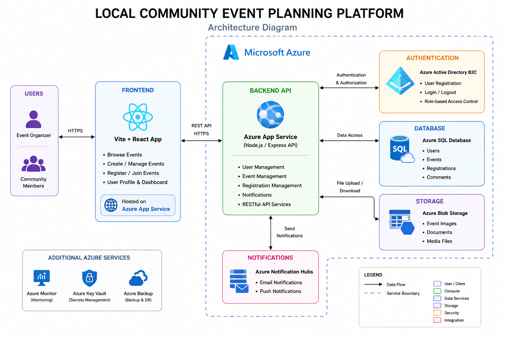
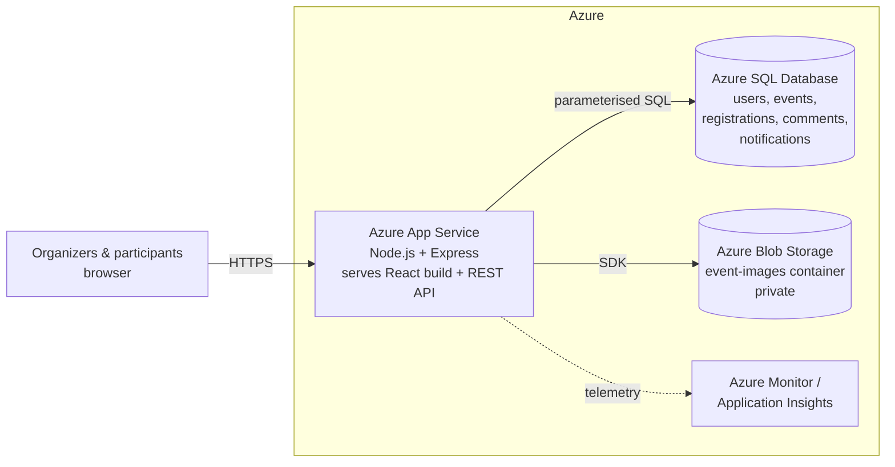

# Local Community Event Planning Platform

A web application that lets neighbourhoods **create, manage, discover and join local community events**. It's built with a **Vite + React** frontend and a **Node.js / Express** REST API, and is designed to be hosted on **Microsoft Azure** (App Service, Azure SQL Database, Blob Storage and Azure Monitor).

The app is branded **Gather** in the UI.

**Team 20, Event Planners:** Sri Ram Sanjay, Monish Ashokan, Srujan Reddy, Charan Sai

---

## Features

| Area | What it does |
| --- | --- |
| **Accounts & roles** | Sign up as a *participant* or an *organizer*. An *admin* role manages users. Passwords are hashed with bcrypt and sessions use signed JWTs. Pages and API routes are protected by role-based access control. |
| **Event management** | Organizers create, edit, cancel and delete events. Each event has a title, description, category, location, start/end time, capacity and an optional cover image. |
| **Discovery** | Anyone can browse upcoming or past events, search by name, place or topic, filter by 10 categories and page through results. |
| **Registration** | One-click registration and cancellation. Capacity is enforced atomically in SQL, so an event can't be overbooked. Duplicate sign-ups are blocked. |
| **Attendee management** | Organizers see who registered and can download the list as CSV (protected against CSV/formula injection). |
| **Comments** | Attendees ask questions on the event page. Organizers are labelled, and authors, organizers and admins can delete comments. |
| **Notifications** | An in-app bell shows registration confirmations, new sign-ups, new comments, time/place changes and cancellations. |
| **Images** | Cover images are uploaded to Azure Blob Storage (or a local folder in development). The container stays private and files are streamed through the API. |
| **Dashboards** | Participants see their upcoming and past events. Organizers see their events with fill-rate meters, sign-up totals and comment counts. |
| **Admin** | Lists all users with activity counts and lets an admin change roles. |
| **Responsive & accessible** | Works from phone to desktop, with keyboard focus styles, a skip link, labelled controls and reduced-motion support. |

## Architecture





| Layer | Technology | Where in the code |
| --- | --- | --- |
| Client | Vite + React 19, React Router | `frontend/src` |
| Application | Node.js 22, Express 5, Zod validation | `backend/src/app.js`, `backend/src/routes` |
| Authentication | bcrypt + JWT, role-based middleware | `backend/src/middleware/auth.js` |
| Data | Azure SQL Database (`mssql` driver) or SQLite locally (`sql.js`) | `backend/src/db` |
| Storage | Azure Blob Storage (`@azure/storage-blob`) or a local folder | `backend/src/services/storage.js` |
| Monitoring | Application Insights (optional) | `backend/src/server.js` |
| Hosting / CI-CD | Azure App Service, GitHub Actions | `.github/workflows/azure-deploy.yml` |

**One codebase, two environments.** With no settings, the API uses a local SQLite file and a local `uploads/` folder, so the project runs on any laptop with zero setup. When Azure connection strings are provided, the same code switches to Azure SQL Database and Azure Blob Storage. Both databases use the same tables and columns (`schema.sqlite.sql` and `schema.mssql.sql`).

## Run it locally

**Requirement:** [Node.js 22 or newer](https://nodejs.org/) (`node -v` to check).

```bash
# 1. Install everything and create the demo database (one time)
npm run setup

# 2. Start the API (port 4000) and the React dev server (port 5173) together
npm run dev
```

Open **http://localhost:5173**.

**On Windows you can just double-click `start-windows.bat`.** It installs everything on the first run, starts the app and opens http://localhost:4000 in your browser.

To run it the way it runs on Azure, with one server serving both the API and the built React app:

```bash
npm start          # builds the frontend, then serves everything at http://localhost:4000
```

### Demo accounts

| Role | Email | Password |
| --- | --- | --- |
| Organizer | `priya@community.local` | `Password123` |
| Organizer | `arjun@community.local` | `Password123` |
| Participant | `meera@community.local` | `Password123` |
| Participant | `rahul@community.local` | `Password123` |
| Admin | `admin@community.local` | `Admin@1234` |

The sign-in page also has a **Demo accounts** shortcut that fills these in. To reset the demo data at any time, run `npm run db:reset --prefix backend`.

### Run the tests

```bash
npm test
```

There are 29 API integration tests (Node's built-in test runner + Supertest, using an in-memory database). They cover sign-up and login, password rules, RBAC, event validation, search (including SQL-injection-style input), registration and capacity limits, attendee CSV export, notifications, comments, image upload validation, path traversal, cancellation and deletion.

## Project structure

```
.
├── backend/                     Node.js + Express REST API
│   ├── src/
│   │   ├── server.js            Startup: monitoring, database, HTTP server
│   │   ├── app.js               Express app: security headers, CORS, rate limits, routes, React hosting
│   │   ├── config.js            Environment-based configuration
│   │   ├── db/
│   │   │   ├── adapters/        mssql.js (Azure SQL) and sqlite.js (local)
│   │   │   ├── schema.mssql.sql Azure SQL schema (T-SQL)
│   │   │   ├── schema.sqlite.sql
│   │   │   ├── migrate.js       npm run db:init / db:reset
│   │   │   └── seed.js          Demo data
│   │   ├── middleware/          auth (JWT + roles), validation (Zod), errors
│   │   ├── routes/              auth, users, events, misc (uploads, files, notifications, stats, health)
│   │   └── services/            storage (Blob / local), notifications
│   ├── test/api.test.js
│   └── .env.example
├── frontend/                    Vite + React app
│   └── src/
│       ├── pages/               Home, EventDetail, EventForm, Auth, Dashboard, Profile, Admin
│       ├── components/          Navbar, EventCard, EventCover, shared UI
│       ├── api.js  auth.jsx  toast.jsx  format.js
│       └── styles.css
├── docs/
│   ├── AZURE_DEPLOYMENT.md      Step-by-step Azure setup (CLI and Portal)
│   ├── API.md                   REST API reference
│   ├── DATABASE.md              Schema and ER diagram
│   └── architecture-diagram.png
├── scripts/prepare-azure.mjs    Builds the frontend into backend/public for deployment
└── .github/workflows/azure-deploy.yml   CI/CD to Azure App Service
```

## Security measures

- **Authentication:** bcrypt password hashing (cost 10), signed JWTs with expiry, and a password policy (8+ characters with a letter and a number). Login uses the same error for unknown email and wrong password, so attackers can't tell which accounts exist.
- **Authorization:** role checks on every protected route (`requireRole`). Only an event's organizer (or an admin) can edit it, manage it or see its attendees. Nobody can self-register as admin.
- **SQL injection:** every query is parameterised. Search input has `LIKE` wildcards escaped.
- **XSS:** React escapes all output. A strict Content-Security-Policy is set via Helmet.
- **Input validation:** every request body and query is validated with Zod (lengths, types, enums, dates, end time after start time).
- **Rate limiting:** 30 login/sign-up attempts per 15 minutes per IP, and 300 API requests per minute per IP.
- **File uploads:** 5 MB limit, image types only, magic bytes checked (a renamed `.exe` is rejected), random UUID file names, a private Blob container, and path-traversal-safe downloads.
- **Transport & data at rest:** HTTPS-only on App Service. Azure SQL and Blob Storage encrypt data at rest by default. Secrets come from App Settings or Key Vault references, never from code.
- **Monitoring:** Application Insights collects requests, failures and dependencies when its connection string is set. `/api/health` is used for the App Service health check.

## Deploying to Azure

See **[docs/AZURE_DEPLOYMENT.md](docs/AZURE_DEPLOYMENT.md)** for complete Azure CLI and Portal steps, covering the resource group, Azure SQL Database, Storage account, App Service, Application Insights, Key Vault and GitHub Actions.

## A note on authentication and Azure AD B2C

The project proposal mentions Azure AD B2C. Microsoft stopped selling Azure AD B2C to new customers on 1 May 2025 and replaced it with **Microsoft Entra External ID**. This implementation therefore uses its own secure JWT authentication, which works on any Azure subscription, including Azure for Students. All identity logic sits in `backend/src/middleware/auth.js`, so moving to Entra External ID later only means changing that module to validate Entra-issued tokens.

## Future scope

AI-based event recommendations, online payments for ticketed events, Android/iOS apps, email/SMS reminders (Azure Communication Services), push notifications (Azure Notification Hubs), Google Maps embeds, QR-code check-in, event ratings and feedback, multi-language support, and multi-factor authentication.
