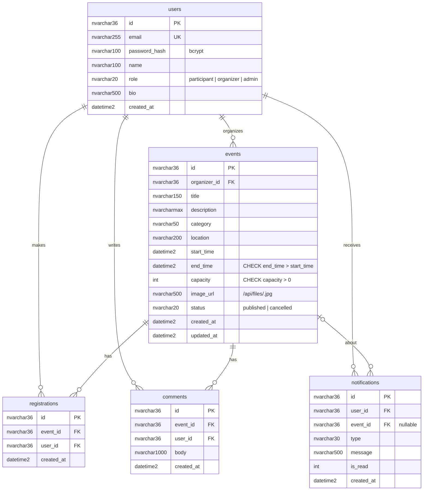

# Database design

The same five tables exist in **Azure SQL Database** (`backend/src/db/schema.mssql.sql`) and in local **SQLite** (`schema.sqlite.sql`). Primary keys are UUIDs generated by the API, and all timestamps are stored in UTC.



## Integrity rules

| Rule | How it is enforced |
| --- | --- |
| One account per email | `UNIQUE (email)`; emails are lower-cased before saving |
| Valid roles / statuses | `CHECK` constraints |
| End time after start time | `CHECK (end_time > start_time)` + API validation |
| A user registers once per event | `UNIQUE (event_id, user_id)` + API check (409) |
| Capacity never exceeded | Conditional insert: `INSERT … SELECT … WHERE (SELECT COUNT(*) …) < @capacity`, checked in a single statement |
| Capacity can't drop below sign-ups | API validation on update |
| Referential integrity | Foreign keys on every relationship |

**Why there's no `ON DELETE CASCADE`.** SQL Server rejects cascades that reach a table through more than one path. For example, `registrations` can be reached both from `users` and from `users → events`. Instead, the API deletes child rows explicitly (notifications → comments → registrations → event) in `DELETE /api/events/:id`.

## Indexes

| Index | Supports |
| --- | --- |
| `events(start_time)` | upcoming/past listing and sorting |
| `events(organizer_id)` | organizer dashboard |
| `events(category)` | category filter |
| `registrations(user_id)` | "my registrations" (event lookups use the unique `(event_id, user_id)` index) |
| `comments(event_id)` | comments per event |
| `notifications(user_id, is_read)` | bell menu and unread count |

## Useful queries (Azure Portal → Query editor)

```sql
-- Most popular upcoming events
SELECT TOP 10 e.title, e.start_time, e.capacity, COUNT(r.id) AS registrations
FROM dbo.events e LEFT JOIN dbo.registrations r ON r.event_id = e.id
WHERE e.status = 'published' AND e.end_time >= SYSUTCDATETIME()
GROUP BY e.title, e.start_time, e.capacity
ORDER BY registrations DESC;

-- Sign-ups per category
SELECT e.category, COUNT(r.id) AS registrations
FROM dbo.events e LEFT JOIN dbo.registrations r ON r.event_id = e.id
GROUP BY e.category ORDER BY registrations DESC;
```
